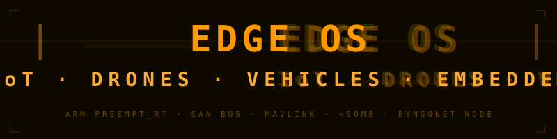
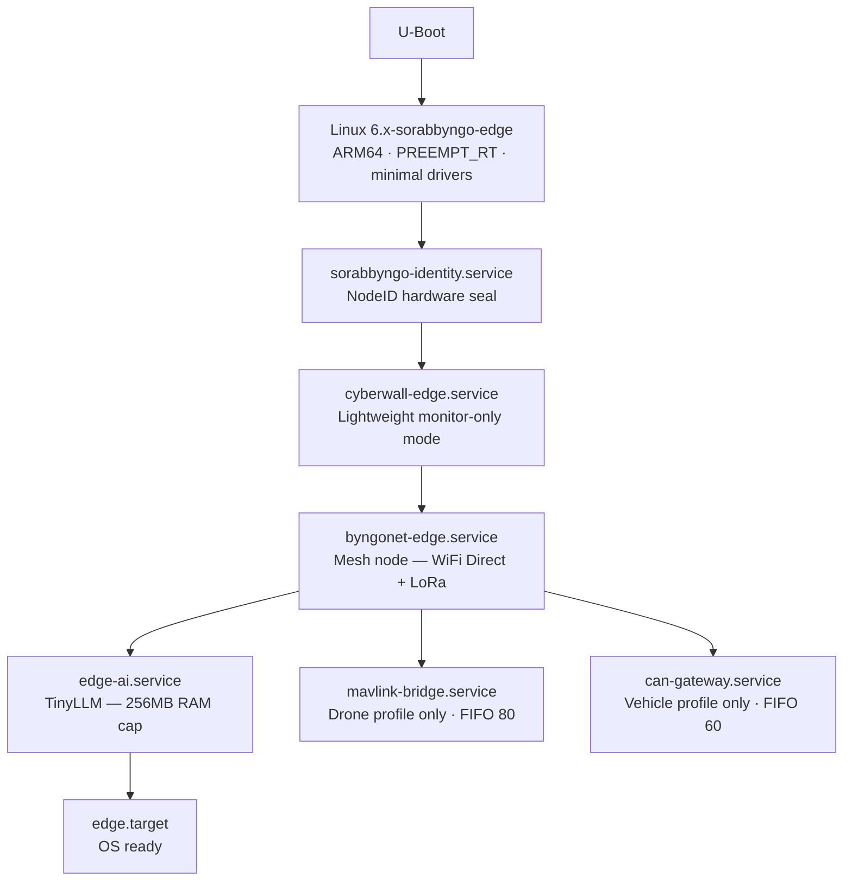

<p align="center">
  
</p>

---

The embedded surface of SORABBYNGO OS. Edge OS runs on drones, vehicles, smart city nodes, IoT sensors, and robotics platforms. Every Edge OS device is a Byngonet mesh node — part of the AI mesh even at the edge of the network.

---

## Boot sequence



---

## Build profiles

```bash
# Drone — MAVLink + GPS + IMU
PROFILE=drone bash scripts/build.sh

# Vehicle — CAN bus + OBD2
PROFILE=vehicle bash scripts/build.sh

# IoT sensor node — minimal + LoRa
PROFILE=iot bash scripts/build.sh

# Raspberry Pi
PROFILE=rpi bash scripts/build.sh
```

---

## What makes it different

| Feature | How |
|---|---|
| Minimal footprint | Target under 50MB rootfs |
| Real-time control | PREEMPT_RT — actuator control < 1ms |
| Drone support | MAVLink bridge — FIFO priority 80 |
| Vehicle support | SocketCAN — 500kbps CAN bus |
| Edge AI | TinyLLM — capped at 256MB RAM |
| Mesh-native | Every device a Byngonet node |
| Lightweight security | Cyberwall monitor-only — 32MB cap |

---

## Services

| Service | Role | Memory |
|---|---|---|
| `cyberwall-edge.service` | Security monitor | 32MB |
| `byngonet-edge.service` | Mesh node | 64MB |
| `edge-ai.service` | TinyLLM inference | 256MB |
| `mavlink-bridge.service` | Drone profile — FIFO 80 | — |
| `can-gateway.service` | Vehicle profile — FIFO 60 | — |
| `edge.target` | Default boot target | — |

---

## Part of SORABBYNGO OS

| OS Surface | Role |
|---|---|
| [Byngo OS](https://github.com/sorabbyngo-os/byngo-os) | Consumer devices |
| [Novela OS](https://github.com/sorabbyngo-os/novela-os) | Medical equipment |
| **Edge OS** | IoT, drones, vehicles — this repo |
| [Server OS](https://github.com/sorabbyngo-os/server-os) | Infrastructure |

---

<p align="center">
  <strong>Sorabbyngo Company</strong> &nbsp;·&nbsp; Kisii, Kenya &nbsp;·&nbsp; 2026<br/>
  <em>Rhythm of Digital Life</em>
</p>
